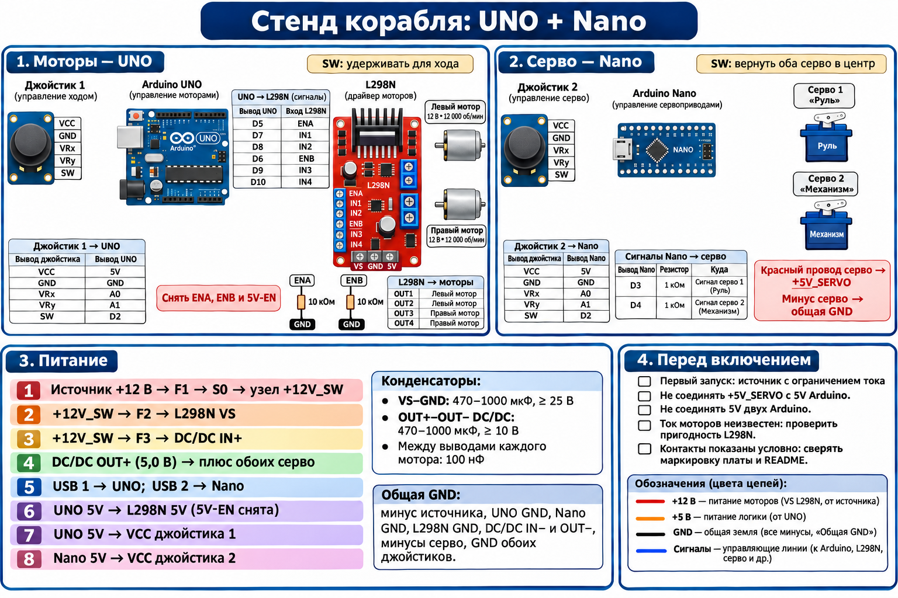

# Ship — стенд управления моделью корабля

Проводной настольный стенд: два коллекторных двигателя 12 В с раздельным управлением через L298N и два позиционных сервопривода Micro Servo 9g. Первый джойстик управляет ходом и поворотом за счёт разницы тяги, второй — рулём и дополнительным механизмом. Радиоуправление в эту версию не входит.

## 1. Состав и принятые допущения

| Узел | Назначение | Скетч |
|---|---|---|
| Arduino UNO R3, ATmega328P, 5 В | Джойстик №1 → L298N → левый и правый мотор | [uno_motors.ino](sketches/uno_motors/uno_motors.ino) |
| Классическая Arduino Nano, ATmega328P, 5 В | Джойстик №2 → два сервопривода | [nano_servos.ino](sketches/nano_servos/nano_servos.ino) |

Платы работают независимо; UART/I²C между ними не нужен. Это позволяет проверять моторы и механизмы отдельно. Подключение не рассчитано на UNO R4, Nano Every, Nano 33 или Nano ESP32 без проверки совместимости.

Нужны именно **двухпроводные коллекторные моторы**. Для бесколлекторных трёхпроводных моторов требуются другие регуляторы. Сервоприводы должны быть позиционными и допускать питание 5 В; надпись «9g» не определяет их напряжение, ток и рабочий диапазон. Для сервоприводов непрерывного вращения этот скетч не подходит.

По данным владельца, моторы рассчитаны на **12 В, 12 000 об/мин**, маркировка не читается. Неизвестно, для какого режима указаны обороты; по напряжению и оборотам нельзя определить ток или мощность.

**Пока неизвестны модели моторов, их токи и источник питания, совместимость с L298N не подтверждена.** Маркировка «2 А» на модуле не гарантирует длительную работу при таком токе. У L298 предел постоянного тока — 2 А на канал при соблюдении тепловых условий; уже при 1 А падение напряжения на мосте составляет около 1,8 В типично и до 3,2 В. Мотор получит меньше напряжения, а драйвер будет греться. Данные: [ST L298, таблицы 1 и 4](https://www.st.com/resource/en/datasheet/l298.pdf).

## 2. Схема питания

### Наглядная сборка



[Открыть изображение в полном размере](docs/images/assembly-guide.png). Иллюстрации плат условные: подключать по названиям контактов из таблиц, а не по их расположению на рисунке. F1/F2/F3 — предохранители, S0 — аварийный выключатель; их выбор описан ниже. Изображение создано встроенным image_gen, [промпты сохранены](docs/images/prompt.md).

Первый запуск — **без гребных винтов**, с закреплёнными моторами и отсоединёнными тягами сервоприводов. Силовые цепи собирать на клеммах/пайке, а не на беспаечной макетной плате.

```text
Источник 12 В (+)
  │
  F1 — предохранитель у источника
  │
  S0 — фиксируемый аварийный выключатель силового питания
  │
  ├── F2 ── L298N клемма +12V / VS ── OUT1/OUT2 ── левый мотор
  │                              └── OUT3/OUT4 ── правый мотор
  │
  └── F3 ── DC/DC 12→5,0 В ── отдельная шина +5V_SERVO
                                   ├── красный провод серво №1
                                   └── красный провод серво №2

USB №1 ── UNO  (питание платы)
             ├── 5V ── джойстик №1 VCC
             └── 5V ── L298N клемма 5V логики (5V-EN СНЯТА!)
USB №2 ── Nano (питание платы)
             └── 5V ── джойстик №2 VCC

Источник 12 В (−) ── общая точка GND
                        ├── L298N GND (отдельный силовой провод)
                        ├── DC/DC IN− и OUT− (для неизолированного DC/DC)
                        ├── земля сервоприводов (отдельный силовой провод)
                        ├── UNO GND и джойстик №1 GND
                        └── Nano GND и джойстик №2 GND
```

**Не соединять +5V_SERVO с 5V, VIN или USB плат Arduino. Не соединять между собой выходы 5V двух плат.** Общими являются земли. Сервоприводы и моторы не питаются от Arduino. Выходы OUT1…OUT4 подключаются только к моторам, не к GND.

S0 разрывает плюс 12 В до обеих силовых ветвей: моторы и сервоприводы теряют питание, контроллеры остаются включены по USB. Выбирать выключатель по **постоянному** напряжению и суммарному току, включая пусковой; слабая тактовая кнопка не подходит. Конденсаторы могут сохранять энергию, а валы — вращаться по инерции. Перед восстановлением питания отпустить кнопку первого джойстика и вернуть оба джойстика в центр: восстановление питания сервоприводов может вызвать движение к текущей команде.

Силовые возвратные токи не должны проходить через Arduino или тонкие перемычки джойстиков. USB предназначены для питания и настройки стенда, а не для питания корабля на воде. Для автономной версии потребуется отдельная проверенная схема питания контроллеров и радиоканал с обработкой потери связи.

### Подготовка модуля L298N

1. При полностью отключённом питании снять перемычки **ENA** и **ENB**: вместо постоянного разрешения будет PWM от UNO.
2. Снять перемычку **5V-EN** встроенного стабилизатора. Только после проверки документации/схемы конкретного модуля подать 5 В от UNO на клемму питания логики. Не путать эту перемычку с ENA/ENB.
3. На разных платах разводка отличается. Убедиться, что после снятия 5V-EN клемма 5V действительно является входом логики и отключена от выхода встроенного стабилизатора. Если назначение неизвестно — не подключать к Arduino до проверки.
4. Установить резисторы **10 кОм ENA→GND и ENB→GND непосредственно у драйвера**. Они выключают мосты, пока UNO загружается, сброшена или отключена.
5. Проверить наличие радиатора и защитных диодов для обоих мостов. Для голой микросхемы L298N нужна отдельная обвязка по даташиту; эта инструкция рассчитана на готовый модуль.

Конденсаторы: 100 нФ непосредственно между выводами каждого мотора; 470–1000 мкФ / ≥25 В между VS и GND около L298N; 470–1000 мкФ / ≥10 В на шине сервоприводов. Проверить наличие керамических 100 нФ у питания VS и логики L298N, добавить при отсутствии. Соблюдать полярность электролитов и требования DC/DC к выходной ёмкости. Конденсаторы уменьшают помехи, но не компенсируют слабый источник питания.

## 3. Сигнальные подключения

### UNO, джойстик №1 и моторы

| Откуда | Куда | Функция |
|---|---|---|
| UNO 5V / GND | Джойстик №1 VCC / GND | Питание джойстика |
| Джойстик №1 VRx | UNO A0 | Поворот |
| Джойстик №1 VRy | UNO A1 | Вперёд / назад |
| Джойстик №1 SW | UNO D2 | Удерживать для разрешения моторов; INPUT_PULLUP |
| UNO D5 | L298N ENA | PWM левого мотора; 10 кОм на GND |
| UNO D7 / D8 | L298N IN1 / IN2 | Направление левого мотора |
| UNO D6 | L298N ENB | PWM правого мотора; 10 кОм на GND |
| UNO D9 / D10 | L298N IN3 / IN4 | Направление правого мотора |
| L298N OUT1 / OUT2 | Два провода левого мотора | Силовой выход A |
| L298N OUT3 / OUT4 | Два провода правого мотора | Силовой выход B |

SW должен замыкаться на GND при нажатии. Можно заменить его отдельной нормально разомкнутой кнопкой D2–GND, которую удобнее удерживать. Не шунтировать эту кнопку постоянно.

### Nano, джойстик №2 и сервоприводы

| Откуда | Куда | Функция |
|---|---|---|
| Nano 5V / GND | Джойстик №2 VCC / GND | Питание джойстика |
| Джойстик №2 VRx / VRy | Nano A0 / A1 | Руль / дополнительный механизм |
| Джойстик №2 SW | Nano D2 | При удержании плавно возвращает оба серво в центр |
| Nano D3 через 1 кОм | Сигнал серво №1 | Руль |
| Nano D4 через 1 кОм | Сигнал серво №2 | Дополнительный механизм |
| +5V_SERVO | Плюс обоих серво | Обычно красный; проверить маркировку |
| Общая GND | Минус обоих серво | Обычно коричневый/чёрный |

Сигнал серво обычно оранжевый/жёлтый/белый; порядок контактов проверять по конкретной модели. Резисторы 1 кОм ограничивают ток через сигнальную линию при раздельном питании, но не обеспечивают гальваническую развязку. Не оставлять контроллеры надолго передающими сигнал на обесточенные серво; после аварийной остановки отключить USB, если работа окончена.

## 4. Как работает управление

**Моторы:** после включения сначала отпустить SW. В центре джойстика нажать и удерживать SW не менее 0,5 с — загорается встроенный LED UNO. Продолжая удерживать кнопку, отклонять джойстик. Отпускание немедленно снимает разрешение в основном цикле; повторный пуск требует нейтрали и нового выдерживания 0,5 с.

Смешивание: `левый = газ + поворот`, `правый = газ − поворот`. При превышении диапазона обе команды нормируются вместе. При нулевом газе поворот даёт противоположное вращение моторов для разворота на месте. При положительном газе и повороте вправо левый мотор работает сильнее правого.

Начальный предел `MAX_PWM = 100` из 255 выбран для наладки. Это **не ограничение тока**: даже при малом PWM неподвижный мотор может перегрузить драйвер. Нарастание команды ограничено шагом 4 каждые 20 мс. При реверсе конкретного мотора PWM сразу отключается, выдерживается минимум 300 мс, затем начинается плавный разгон в другую сторону. При нейтрали/отпускании используется свободный выбег, не активное торможение. Для тяжёлого винта паузу нужно увеличить по измеренному времени остановки.

**Серво:** X второго джойстика задаёт положение руля, Y — второго механизма. В центре — импульс 1500 мкс. Начальный диапазон 1200–1800 мкс и изменение не более 10 мкс каждые 20 мс. Нажатие SW удерживает целевое положение обоих серво в центре; отпускание возвращает управление осям. Это не аварийный останов. На старте серво сразу получают центр: установить качалки и тяги только после проверки центра без нагрузки.

Управление положением абсолютное: отпущенный подпружиненный джойстик возвращает механизм в центр. Для лебёдки или механизма, который должен сохранять последнее положение, потребуется другая логика.

Программное выключение не защищает от зависания контроллера, замыкания проводов или неисправности силового моста. Обрыв аналогового провода джойстика программно достоверно не определяется. S0 и предохранители обязательны; стенд обслуживается оператором.

## 5. Номенклатура

| Компонент | Количество | Требования / примечание |
|---|---:|---|
| Arduino UNO R3 и классическая Nano | По 1 | Имеются, 5 В / ATmega328P |
| Двухосевой аналоговый джойстик с SW | 2 | Имеются, выходы VRx/VRy 0…5 В |
| Модуль L298N | 1 | Имеется; радиатор, диоды, доступ к ENA/ENB |
| Коллекторный мотор 12 В, 12 000 об/мин | 2 | Имеются; маркировка неизвестна, токи требуют проверки |
| Позиционный Micro Servo 9g | 2 для базовой сборки | Имеются; проверить допустимость 5 В |
| Лабораторный источник 12 В с ограничением тока | 1 | Для первого запуска предпочтительнее аккумулятора; ток выбрать после измерений |
| DC/DC 12→5 В или UBEC 5 В | 1 | Для двух малых серво ориентир 3 А непрерывно, но окончательно по сумме пиковых токов; проверить нагрев и просадку |
| USB-кабели для UNO и Nano | По 1 | Разъёмы по фактическим платам, кабели передачи данных |
| S0, фиксируемый выключатель силового питания | 1 | DC-рейтинг выше рабочего напряжения и расчётного тока |
| Держатели предохранителей F1/F2/F3 + предохранители | 3 комплекта | Номиналы по токам ветвей и допустимому току проводов |
| Резисторы 10 кОм, 0,125–0,25 Вт | 2 | Подтяжка ENA/ENB к GND |
| Резисторы 1 кОм, 0,125–0,25 Вт | 2 | Последовательно с сигналами серво |
| Керамика 100 нФ, ≥50 В | 4 | Два на моторы, ещё два при отсутствии развязки питания модуля |
| Электролит 470–1000 мкФ, ≥25 В | 1 | Вход питания L298N |
| Электролит 470–1000 мкФ, ≥10 В | 1 | Шина серво; согласовать с DC/DC |
| Клеммники, силовой провод, разъёмы, термоусадка | Комплект | Сечение и контакты по току/длине; Dupont только для сигналов |
| Монтажная основа, крепления моторов, защитный кожух | Комплект | Исключить перемещение и контакт с вращающимися деталями |
| Мультиметр, желательно термометр | По 1 | Проверка напряжения, тока и температуры |
| Отдельная кнопка разрешения, нормально разомкнутая | Опционально 1 | Вместо SW первого джойстика |

### Выбор источника, защиты и драйвера

Нужно узнать ток холостого хода, рабочий ток с винтом и пусковой/стопорный ток **каждого** мотора. В первую очередь использовать паспорт двигателя. Не удерживать вал рукой и не измерять стопорный ток через L298N. При отсутствии паспорта метод измерения с ограниченным током и коротким импульсом нужно выбирать отдельно по мотору и измерительной аппаратуре.

Оценка тока источника: `I12 ≥ Iлев + Iправ + (5 × Iсерво)/(12 × КПД_DC/DC)`, плюс запас и проверка одновременного пуска. Значения в этой формуле относятся к соответствующему режиму нагрузки; источник должен переживать пиковые токи, а не только средний ход. USB-питание плат здесь считается отдельно.

F1 защищает общий провод, F2 — моторную ветвь, F3 — вход DC/DC. Выбирать по времятоковой характеристике, пусковым токам, DC-напряжению и отключающей способности. Номинал не должен превышать допустимый ток защищаемого провода/разъёма. Предохранитель не гарантирует спасение L298N при перегрузке. Конкретные амперы нельзя корректно указать без данных моторов и проводки.

Если пусковой/рабочий ток не укладывается в возможности L298N и охлаждения, заменить его на два подходящих MOSFET-моста либо два реверсивных регулятора коллекторных моторов, рассчитанных на 12 В, пуск и заклинивание. Их интерфейс может потребовать изменения схемы и скетча. Увеличение PWM или предохранителя эту проблему не решает.

## 6. Прошивка

1. Установить Arduino IDE, пакет **Arduino AVR Boards** через Boards Manager и библиотеку **Servo** от Arduino через Library Manager.
2. Открыть `sketches/uno_motors/uno_motors.ino`, выбрать **Arduino Uno**, нужный порт, проверить и загрузить.
3. Открыть `sketches/nano_servos/nano_servos.ino`, выбрать **Arduino Nano**, процессор **ATmega328P**, порт второй платы, проверить и загрузить. Для некоторых старых Nano/клонов нужен **ATmega328P (Old Bootloader)**; при ошибке синхронизации проверить этот вариант, порт и USB-кабель.
4. Во время прошивки выключить S0. Затем выполнить порядок первого запуска ниже.
5. Монитор порта каждой платы: **115200 бод**. UNO выводит X/Y и `armed`, Nano — X/Y и длительность импульсов.

При наличии Arduino CLI:

```powershell
arduino-cli core install arduino:avr
arduino-cli lib install Servo
arduino-cli compile --fqbn arduino:avr:uno sketches/uno_motors
arduino-cli compile --fqbn arduino:avr:nano:cpu=atmega328 sketches/nano_servos
arduino-cli compile --fqbn arduino:avr:nano:cpu=atmega328old sketches/nano_servos
```

Об устройстве установки пакетов: [Arduino Boards Manager](https://docs.arduino.cc/software/ide-v2/tutorials/ide-v2-board-manager/). Библиотека [Arduino Servo](https://github.com/arduino-libraries/Servo) использует таймер и на ATmega328P отключает обычный PWM на D9/D10; в нашей схеме она работает на отдельной Nano, а PWM моторов UNO находится на D5/D6.

## 7. Первый запуск и приёмочная проверка

1. Снять винты, закрепить моторы, снять тяги с серво. Всё обесточить, проверить таблицы соединений и отсутствие замыканий. Не измерять ток, подключая амперметр поперёк источника.
2. Пока выход DC/DC отсоединён от серво, выставить и измерить **5,0 В**. Выключить питание перед подключением серво. Проверить полярность и общее соединение GND.
3. Включить USB плат при выключенном S0. На UNO LED разрешения должен быть погашен. По монитору порта измерить X/Y в нейтрали и записать их в `CENTER_X/Y` соответствующего скетча, прошить повторно. Центр должен быть в диапазоне `DEAD_ZONE < CENTER < 1023 − DEAD_ZONE`; ожидается около 512. Не маскировать неисправность джойстика большой мёртвой зоной.
4. Сначала проверить серво с отсоединённой моторной ветвью F2: включить S0, проверить центр, обе оси и кнопку центрирования. Проверить, что серво не гудят на упорах и не перегреваются. Выключить питание перед изменением соединений.
5. Подключить моторную ветвь. Включить силовое питание с ограничением тока источника, выбранным по мотору и безопасному режиму драйвера. При отпущенной кнопке и любом отклонении первого джойстика моторы должны стоять.
6. Нажать кнопку при отклонённом джойстике: запуска быть не должно. Вернуть в центр и удержать 0,5 с: LED загорается. Небольшое отклонение вперёд должно давать тягу вперёд обоими моторами. При необходимости изменить `INVERT_Y`, `INVERT_X`, `INVERT_LEFT/RIGHT`; либо при выключенном питании поменять два провода нужного мотора. Не менять оба способа одновременно.
7. Проверить поворот, нейтраль, отпускание кнопки, реверс с паузой, сброс UNO и отключение её USB. ENA/ENB должны удерживаться в нуле при отключённой плате. При удержанной кнопке во время загрузки движение блокируется до первого отпускания.
8. Проверить S0 на малой мощности: моторы теряют питание, серво — удерживающее усилие. Перед включением снова отпустить кнопку и вернуть джойстики в центр. При отключении только силового питания UNO не сбрасывается: не восстанавливать его с удержанной кнопкой разрешения.
9. Контролировать токи, напряжение 5 В и нагрев драйвера/проводов. При просадках, запахе, рывках или быстром нагреве выключить стенд и устранить причину. Не увеличивать PWM, пытаясь преодолеть срабатывание ограничения тока.
10. Только после этих проверок установить механику, ограничить ходы под реальные тяги и организовать защищённое испытание винтов. Нагрузка в воде существенно отличается от холостого хода; успешная настольная проверка не подтверждает допустимость драйвера на воде.

Левый и правый винты должны создавать тягу в одном направлении при команде «вперёд»; противоположное вращение валов может быть нормальным для винтов разной направленности. Проверять тягу и ориентацию винтов, а не только визуальное вращение.

## 8. Настройки и расширение

Константы находятся в начале скетчей. На UNO: центры осей, мёртвая зона, инверсия осей/моторов, `MAX_PWM` (1…255), `REVERSE_PAUSE_MS`, `RAMP_STEP`. На Nano: центры, инверсия, `MIN_US/CENTER_US/MAX_US`, `STEP_US`. Расширять диапазон импульсов постепенно без тяг; 0–180° для неизвестного сервопривода не гарантированы.

Для дополнительных серво можно добавить объекты `Servo` и свободные цифровые выводы Nano; для каждого нового механизма нужно определить источник команды. Базовый скетч управляет только двумя. При большом количестве приводов целесообразен отдельный контроллер PWM, например PCA9685, и пересчёт силового питания по суммарным пикам. Помпы, освещение и лебёдки нельзя питать от GPIO: им нужны отдельные силовые ключи/драйверы и защита индуктивной нагрузки.

## 9. Статус проверки

Скетчи предназначены для компиляции под Arduino AVR. Результаты программной проверки приведены в [docs/validation.md](docs/validation.md). Физическая сборка, токи, тепловой режим, направления тяги и работа конкретных сервоприводов требуют проверки на вашем оборудовании по разделу 7.
